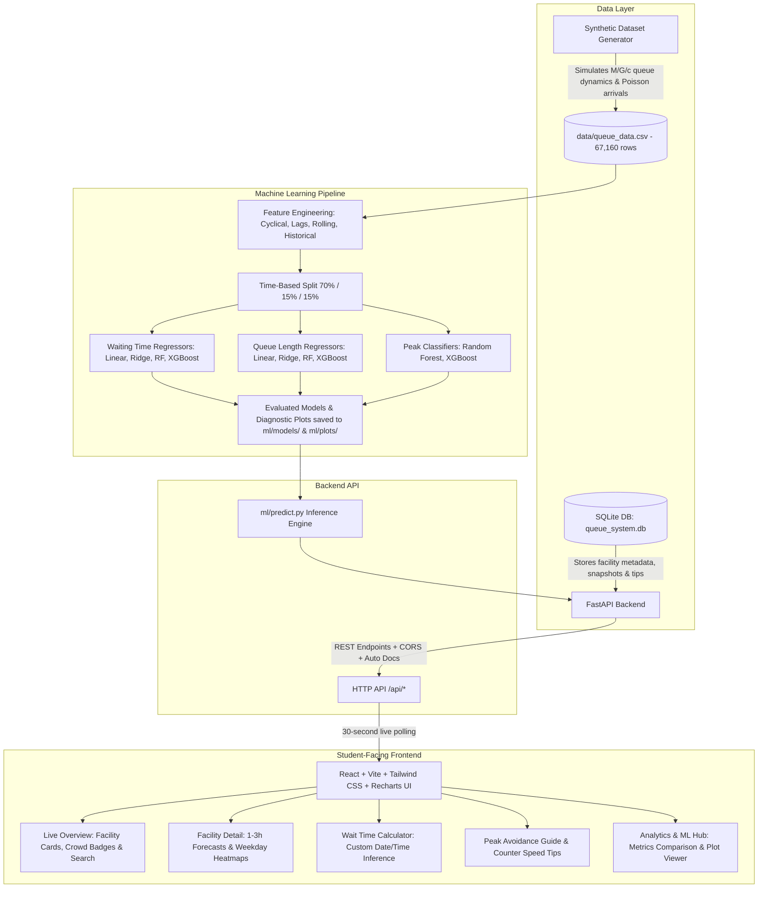

# Intelligent Queue Prediction & Management System
**Supervised Machine Learning Coursework Project**

An end-to-end full-stack machine learning application designed to predict waiting times and queue lengths at university facilities (Admin Office, Main Cafeteria, Student Services Counter, Library Desk, and Fee Payment Counter), detect congestion bottlenecks, and empower students to choose optimal visit times.

---

## Architecture Overview



---

## Key Features

1. **Synthetic Campus Dataset (67,160 rows across 6 months)**:
   - Covers 5 distinct university facilities:
     - **FAC_01**: Admin Office (Document Verification, Transcripts, Student IDs)
     - **FAC_02**: Main Cafeteria (Meal Purchase, Snacks & Beverages, Express Counters)
     - **FAC_03**: Student Services Counter (Academic Advising, Financial Aid, Housing)
     - **FAC_04**: Library Desk (Checkout/Return, Study Room Booking, Reference Desk)
     - **FAC_05**: Fee Payment Counter (Tuition Installments, Fine Payments, Scholarships)
   - Realistic Poisson arrivals capturing lunch rushes (12:00-14:00), class break bursts, registration weeks, exam periods, and fee payment deadlines.
   - Log-normal service times, dynamic counter scaling, and weekend/holiday calendars.

2. **Supervised Learning Pipeline (`ml/train.py` & `ml/predict.py`)**:
   - **Feature Engineering**: Cyclical hour encodings (`hour_sin`, `hour_cos`, `dow_sin`, `dow_cos`), lag queues (`lag_1`, `lag_2`, `lag_3`), rolling averages (30-min wait, 1-hr arrivals), same-hour historical baselines, and one-hot categorical encodings.
   - **Time-Based Splitting**: 70% Train, 15% Validation, 15% Test chronologically to prevent lookahead leakage.
   - **Model Comparison**:
     - *Waiting Time*: **XGBoost Regressor (Test $R^2 = 0.9791$, MAE $= 1.49$ min)**
     - *Queue Length*: **Linear Regressor (Test $R^2 = 0.9999$, MAE $= 0.05$ people)**
     - *Peak Classifier*: **XGBoost Classifier (Test F1 $= 0.9847$, Accuracy $= 98.78\%$)**
   - **Automated Diagnostic Visualizations** saved to `ml/plots/`: Actual vs Predicted, Residual distributions, Top feature importances, and Confusion Matrix.

3. **Backend API (`FastAPI` + `SQLite SQLAlchemy`)**:
   - `GET /api/facilities`: List facilities with live status, wait time, queue length, and crowd badge.
   - `GET /api/facilities/{id}/status`: Real-time status, open counters, and queue trend (`rising`/`falling`/`steady`).
   - `GET /api/facilities/{id}/forecast?hours=3`: 15-minute interval queue and wait forecasts.
   - `POST /api/predict`: Custom inference for any selected facility and future date/time.
   - `GET /api/facilities/{id}/best-time`: Top 3 recommended slots today with minimum queue wait.
   - `GET /api/facilities/{id}/hourly-pattern`: Weekday × Hour average wait matrix (heatmap data).
   - `GET /api/peaks`: Detected campus bottleneck periods and causal explanations.
   - `GET /api/recommendations`: Real-time student advisories and express counter throughput tips.
   - `GET /api/analytics/trends`: Multi-month daily volume and day-of-week trends.
   - `GET /api/model/metrics`: Model benchmark scores (MAE, RMSE, $R^2$, Accuracy, F1) and feature rankings.
   - Interactive Swagger documentation at `http://localhost:8000/docs`.

4. **Modern Student UI (`React` + `Vite` + `Tailwind CSS` + `Recharts`)**:
   - **Live Polling**: Background refresh every 30 seconds with countdown badge and manual trigger.
   - **Light / Dark Mode**: Seamless toggle with persisted user preference.
   - **Search & Filter**: Real-time search across facility names, locations, and category pills.
   - **Interactive Charts**: Responsive dual-axis forecast line charts, hourly crowd bar charts, weekly color-coded heatmaps, and ML diagnostic image viewer.

---

## Directory Structure

```text
Intelligent-Queue-Prediction-Management-System/
├── backend/
│   └── app/
│       ├── api/
│       │   └── routes.py              # 10 REST API endpoints
│       ├── models/
│       │   ├── db_models.py           # SQLAlchemy tables (Facility, Snapshot, Recommendation)
│       │   └── schemas.py             # Pydantic schemas for requests/responses
│       ├── services/
│       │   └── queue_service.py       # Replay simulator, live cache & sensor hooks
│       ├── database.py                # SQLite connection & session maker
│       └── main.py                    # FastAPI app, CORS, static mounts & SPA fallback
├── data/
│   ├── generate_dataset.py            # 67,160-row realistic synthetic queue simulator
│   └── queue_data.csv                 # 6-month synthetic dataset (30 columns)
├── ml/
│   ├── models/
│   │   ├── best_wait_time_model.joblib
│   │   ├── best_queue_length_model.joblib
│   │   ├── best_peak_classifier.joblib
│   │   ├── feature_importance.json
│   │   ├── feature_names.json
│   │   ├── historical_hourly_lookup.csv
│   │   └── metrics.json               # Full evaluation report across all models
│   ├── plots/                         # Generated diagnostic plots (PNG)
│   │   ├── actual_vs_predicted_wait_time.png
│   │   ├── actual_vs_predicted_queue_length.png
│   │   ├── residuals_distribution.png
│   │   ├── feature_importance.png
│   │   ├── confusion_matrix_peak.png
│   │   └── model_comparison_bar.png
│   ├── predict.py                     # Reusable inference functions & heuristics
│   └── train.py                       # ML pipeline (cleaning, engineering, training, eval)
├── frontend/                          # React + Vite + Tailwind CSS + Recharts
│   ├── src/
│   │   ├── components/
│   │   │   ├── AnalyticsHub.tsx       # ML metrics, trend lines & plot gallery
│   │   │   ├── FacilityCard.tsx       # Live status card with crowd badges
│   │   │   ├── FacilityDetail.tsx     # Forecast charts, best times & weekly heatmap
│   │   │   ├── Navbar.tsx             # Navigation, 30s counter & theme toggle
│   │   │   ├── PeakGuides.tsx         # Bottleneck schedule & fast-track tips
│   │   │   └── WaitTimePredictor.tsx  # Point inference interactive calculator
│   │   ├── services/
│   │   │   └── api.ts                 # Typed fetch client
│   │   ├── App.tsx                    # Top-level view coordinator & polling state
│   │   ├── index.css                  # Tailwind styles
│   │   └── main.tsx                   # React root entry
│   ├── dist/                          # Production-ready build served by backend
│   └── vite.config.ts                 # Vite setup with Tailwind and API proxy
└── run_system.py                      # Unified single-command launcher
```

---

## Getting Started

### 1. Prerequisites
- **Python**: 3.10+ (tested on Python 3.13)
- **Node.js**: v18+ (tested on Node v22)

### 2. Quick Start (Single Launcher)
The application has already precompiled the frontend build into `frontend/dist/`. You can launch both the API and student dashboard together:

```bash
cd Intelligent-Queue-Prediction-Management-System
python run_system.py
```

Then visit:
- **Student Dashboard**: [http://localhost:8000](http://localhost:8000)
- **Interactive API Docs**: [http://localhost:8000/docs](http://localhost:8000/docs)

### 3. Running in Development Mode

#### Backend Server:
```bash
cd Intelligent-Queue-Prediction-Management-System
python -m uvicorn backend.app.main:app --host 127.0.0.1 --port 8000 --reload
```

#### Frontend Development Server:
```bash
cd Intelligent-Queue-Prediction-Management-System/frontend
npm run dev
```
Open [http://localhost:5173](http://localhost:5173). The Vite dev server automatically proxies all `/api` calls to the FastAPI backend at port 8000.

---

## Reproducing Dataset & Retraining Models

To regenerate the dataset from scratch:
```bash
python data/generate_dataset.py
```

To run the complete machine learning training pipeline, benchmark all regression/classification models, and generate all diagnostic charts:
```bash
python ml/train.py
```

---

## Hardware Sensor & Kiosk Integration

In a production campus deployment with computer vision people-counters or electronic ticketing kiosks (e.g. Qmatic or Nemo-Q):
1. The camera or kiosk publishes a message upon people count changes.
2. In `backend/app/services/queue_service.py`, call:
   ```python
   record_realtime_sensor_event(
       facility_id="FAC_02",
       queue_count=18,
       counters_open=4,
       source="Overhead CV Camera"
   )
   ```
3. The backend caches the live physical reading, stores an audit snapshot in SQLite, and the student dashboard updates automatically via its 30-second polling cycle.
